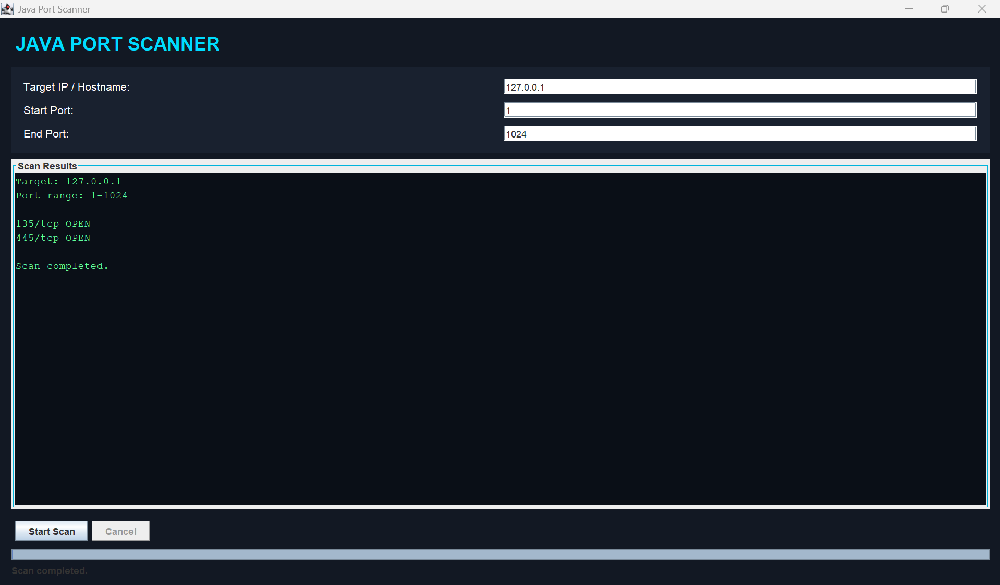
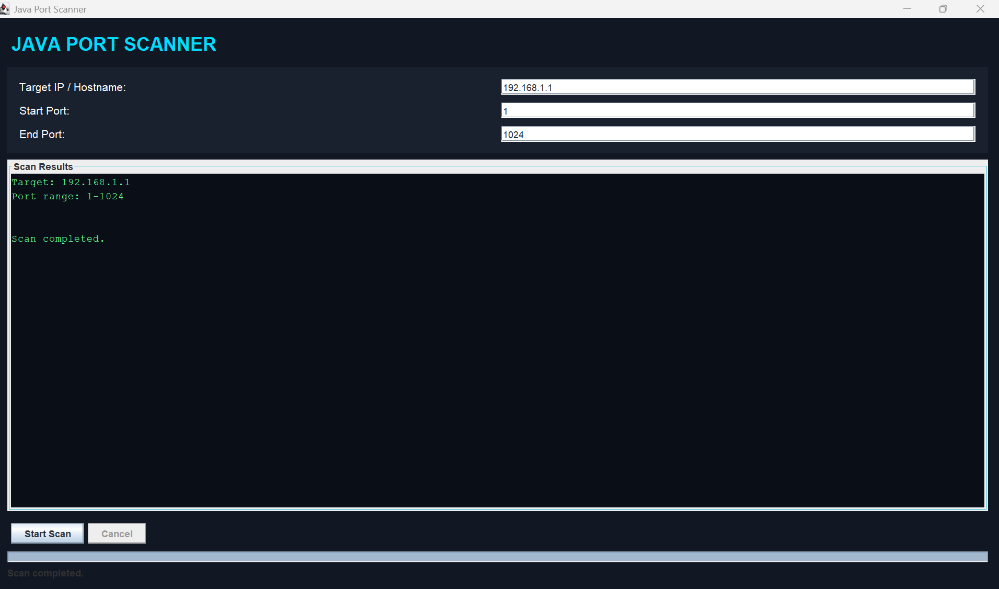
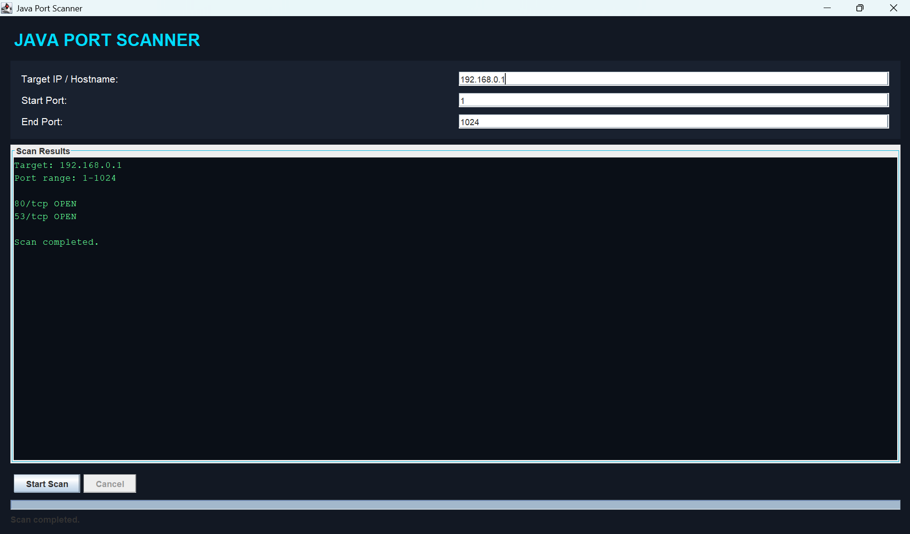

# Java Network Port Scanner

A multithreaded TCP network port scanner built with Java Swing for educational cybersecurity and network security testing.

<p align="center">
  
  
  
  
</p>

<p align="center">
  A beginner-friendly cybersecurity project that scans TCP ports and identifies potentially accessible network services.
</p>

---

## Project Screenshots

### Screenshot 1



### Screenshot 2



### Screenshot 3



---

## About the Project

The **Java Network Port Scanner** is a desktop application developed using Java and Java Swing. It allows users to scan a specified IP address or hostname and check which TCP ports accept connections.

Port scanning is an important technique in network administration and cybersecurity. It helps users understand network exposure and identify services that may require further security assessment.

This project was developed as a practical learning exercise in Java programming, computer networking, and cybersecurity fundamentals.

## Features

- **IP Address and Hostname Scanning** — Specify a target host for scanning.
- **Custom Port Range** — Select the starting and ending ports.
- **Multithreaded Scanning** — Scan multiple ports concurrently.
- **Open Port Detection** — Identify ports that accept TCP connections.
- **Common Service Identification** — Display likely services associated with well-known port numbers.
- **Connection Timeout** — Limit the time spent waiting for a connection.
- **Input Validation** — Validate target and port-range inputs.
- **Graphical User Interface** — Interact with the application through Java Swing.
- **Scan Results** — View detected open ports and scan status.
- **Clear Results** — Clear previous scan output before a new scan.

*Note: Confirm that each feature matches the implementation in your source code before publishing.*

## Technologies Used

| Technology | Purpose |
|---|---|
| Java | Core programming language |
| Java Swing | Graphical user interface |
| Java Networking API | TCP socket connections |
| ExecutorService | Concurrent port scanning, if implemented |
| Exception Handling | Handling connection failures and timeouts |
| Git and GitHub | Version control and project hosting |

## How It Works

1. Enter the IP address or hostname of a system you are authorized to test.
2. Specify the starting and ending TCP port numbers.
3. Start the scan.
4. The application attempts TCP connections to the selected ports.
5. Ports that accept connections are reported as open.
6. Review the results for educational or authorized network assessment.

### Understanding Port Scan Results

| Result | Meaning |
|---|---|
| Open | A TCP connection was successfully established. |
| Closed | The target actively refused the connection. |
| Filtered / Timeout | A firewall, network condition, or timeout may have prevented a clear result. |

The application may not distinguish every network condition. A timeout alone does not prove that a port is filtered.

## Installation and Setup

### Prerequisites

- Java Development Kit (JDK)
- A Java-compatible IDE, such as IntelliJ IDEA, Eclipse, or Visual Studio Code with Java extensions
- Git (optional, for cloning the repository)

### Step 1: Clone the Repository

```bash
git clone https://github.com/MaheshNadun2004/java-network-port-scanner.git
```

### Step 2: Open the Project

Open the cloned project directory in your Java IDE.

### Step 3: Compile the Application

If your project uses a standard Java source file, compile it with:

```bash
javac YourMainClass.java
```

Replace `YourMainClass.java` with the actual filename containing your application's entry point.

### Step 4: Run the Application

```bash
java YourMainClass
```

Replace `YourMainClass` with the actual class name containing the `main` method.

**Important:** These commands are examples for a standalone Java source file. If your project contains multiple classes, packages, or external dependencies, follow the actual project structure and compile accordingly.

## Example Usage

For a system you own or have permission to test:

```text
Target Host: 127.0.0.1
Start Port: 1
End Port: 1024
```

`127.0.0.1` refers to your own computer. The results depend on which local services are listening.

## Learning Outcomes

Through this project, I practised:

- Java socket programming
- TCP networking fundamentals
- Port scanning concepts
- Multithreading and concurrent execution
- Exception handling and connection timeouts
- GUI development with Java Swing
- Basic network security assessment

## Future Improvements

Potential enhancements include:

- Scan progress bar and estimated completion time
- Export results to CSV or text reports
- Improved cancellation and timeout controls
- More detailed service detection
- Scan history and result filtering
- Unit tests and automated testing
- Better error messages and input validation

## Ethical Use and Disclaimer

This tool is intended for educational purposes and authorized network testing.

- Scan only systems you own or have explicit permission to assess.
- Obtain authorization before testing organizational or third-party networks.
- Do not use this project to disrupt services or access systems without permission.

The developer is not responsible for misuse of this software.

## Author

**Mahesh Nadun**

BICT Undergraduate | Aspiring Penetration Tester | Cybersecurity Enthusiast

- GitHub: [@MaheshNadun2004](https://github.com/MaheshNadun2004)
- Project Repository: [java-network-port-scanner](https://github.com/MaheshNadun2004/java-network-port-scanner)

## License

This project is available for educational use. If you want others to reuse, modify, and distribute the code under defined terms, consider adding an appropriate open-source license file to the repository.

---

<p align="center">
  <b>Built with Java | Learning Networking | Exploring Cybersecurity</b>
</p>
